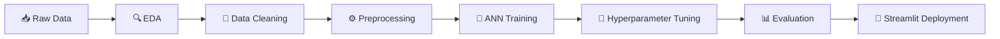

<div align="center">

# 💰 Intelligent Anti-Money Laundering Detection System

### Using Artificial Neural Networks

[](https://python.org)
[](https://tensorflow.org)
[](https://streamlit.io)
[](LICENSE)

*An AI-powered system that detects suspicious financial transactions using deep learning, replacing traditional rule-based AML systems with intelligent pattern recognition.*

---

[Features](#-features) · [Demo](#-demo) · [Installation](#-installation) · [Usage](#-usage) · [Model Architecture](#-model-architecture) · [Dataset](#-dataset)

</div>

---

## 🎯 Problem Statement

Traditional rule-based Anti-Money Laundering (AML) systems generate a **large number of false alerts** and fail to detect sophisticated laundering patterns. Financial institutions need a smarter approach that can:

- 🔍 Identify complex money laundering patterns that evade rule-based systems
- 📉 Significantly reduce false positive rates
- ⚡ Provide real-time transaction monitoring
- 📋 Support regulatory compliance requirements

## ✨ Features

| Feature | Description |
|---------|-------------|
| 🧠 **Deep Learning Model** | ANN built with TensorFlow/Keras for binary classification of transactions |
| 🌐 **Interactive Web App** | Streamlit-based UI for real-time transaction screening |
| 📊 **Comprehensive EDA** | Univariate & bivariate analysis with detailed visualizations |
| ⚖️ **Imbalanced Data Handling** | Techniques to handle the extreme class imbalance (only 0.1% suspicious) |
| 🔧 **Hyperparameter Tuning** | Optimized model architecture for maximum detection accuracy |
| 🎨 **Beautiful UI** | Dark-themed interface with intuitive transaction input forms |

## 🖥️ Demo

The Streamlit web application provides an intuitive interface to check transactions:

```
💰 Intelligent AML Detection System
├── Enter transaction amount
├── Select payment & received currencies
├── Choose sender & receiver bank locations
├── Pick payment type
└── Get instant prediction → ✅ Legitimate or 🚨 Suspicious
```

**Supported Payment Types:** Cash Withdrawal, ACH, Cash Deposit, Cheque, Debit Card, Cross-border, Credit Card

**Supported Currencies:** UK Pounds, Euro, Turkish Lira, Swiss Franc, Dirham, Pakistani Rupee, Naira, US Dollar, Yen, Moroccan Dirham, Mexican Peso, Albanian Lek, Indian Rupee

**Bank Locations:** UK, Turkey, Switzerland, Pakistan, UAE, Nigeria, Spain, Germany, USA, Italy, France, Japan, Morocco, Austria, Mexico, Albania, India, Netherlands

## 🚀 Installation

### Prerequisites

- Python 3.x
- pip package manager

### Setup

```bash
# Clone the repository
git clone https://github.com/kvik0802/AML-Detection-System.git
cd AML-Detection-System

# Install dependencies
pip install streamlit pandas numpy tensorflow joblib

# Run the application
streamlit run app.py
```

## 📖 Usage

### Web Application

```bash
streamlit run app.py
```

This launches the interactive transaction screening interface where you can:

1. **Enter transaction details** — amount, currencies, bank locations, and payment type
2. **Submit for analysis** — the ANN model processes the transaction in real-time
3. **View results** — see the suspicious probability score with a clear verdict

### Jupyter Notebook

Open the notebook to explore the complete ML pipeline:

```bash
jupyter notebook "Intelligent_Anti-Money_Laundering_Detection_System_Using_Artificial_Neural_Networks__2_.ipynb"
```

## 🧠 Model Architecture

```
Input Layer (Transaction Features)
        │
        ▼
  ┌─────────────┐
  │  Dense Layer │  ← Feature extraction
  │  + ReLU      │
  └──────┬──────┘
         │
         ▼
  ┌─────────────┐
  │  Dense Layer │  ← Pattern recognition
  │  + ReLU      │
  └──────┬──────┘
         │
         ▼
  ┌─────────────┐
  │  Output      │  ← Sigmoid activation
  │  (0 or 1)    │     Legitimate vs Suspicious
  └─────────────┘
```

### Pipeline

```
Raw Data → Preprocessing (Encoding + Scaling) → ANN Training → Hyperparameter Tuning → Evaluation → Deployment
```

## 📊 Dataset

The project uses the **SAML-D (Synthetic Anti-Money Laundering Dataset)**:

| Property | Value |
|----------|-------|
| **Total Transactions** | 9,504,852 |
| **Suspicious Rate** | 0.1039% |
| **Features** | 12 |
| **Typologies** | 28 (11 normal + 17 suspicious) |
| **Network Structures** | 15 graphical structures |

### Key Features

- **Time & Date** — Transaction chronology tracking
- **Sender/Receiver Account** — Behavioral pattern analysis
- **Amount** — Transaction value for suspicious activity identification
- **Payment Type** — Credit card, debit card, cash, ACH, cross-border, cheque
- **Bank Locations** — High-risk region identification (Mexico, Turkey, Morocco, UAE)
- **Currencies** — Cross-border transaction complexity detection
- **Is Suspicious** — Binary label (target variable)
- **Laundering Type** — Typology classification

## 🛠️ Tech Stack

<div align="center">

| Technology | Purpose |
|:----------:|:-------:|
|  | Core Language |
|  | Deep Learning Framework |
|  | Data Manipulation |
|  | Numerical Computing |
|  | Web Application |
|  | Analysis Notebook |

</div>

## 📂 Project Structure

```
AML-Detection-System/
│
├── 📓 Intelligent_Anti-Money_Laundering_Detection_System_Using_Artificial_Neural_Networks__2_.ipynb
│                                          # Complete ML pipeline — EDA, preprocessing, model training & evaluation
├── 🌐 app.py                              # Streamlit web application for real-time transaction screening
├── 🧠 AML.keras                           # Trained ANN model (Keras format)
├── ⚙️ preprocessor                        # Fitted sklearn preprocessing pipeline (joblib)
└── 📄 README.md                           # Project documentation
```

## 📈 Workflow



## 🤝 Contributing

Contributions are welcome! Feel free to:

1. Fork the repository
2. Create a feature branch (`git checkout -b feature/amazing-feature`)
3. Commit your changes (`git commit -m 'Add amazing feature'`)
4. Push to the branch (`git push origin feature/amazing-feature`)
5. Open a Pull Request

## 📄 License

This project is licensed under the MIT License — see the [LICENSE](LICENSE) file for details.

---

<div align="center">

**⭐ If you found this project useful, please give it a star!**

Made with ❤️ for financial security

</div>

